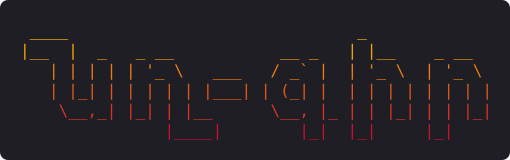

<p align="center">
  
</p>

# nx-gir

**A terminal book reader built for Grabar (Classical Armenian) texts.**

nx-gir (from Armenian *գիր*, "letter, script") is a book reader that runs in the
terminal. Its main goal is to make old Armenian texts easier to read: Grabar
books, early printed editions, and scanned manuscripts. It also turns scanned
PDFs and images into plain text, so a page photo can be read like any other book.

> **Status:** early planning. This README describes what the project is meant to do.
> None of it is implemented yet.

## Goals

### 1. Terminal reader

- Read `.txt`, `.md`, `.epub`, and text-based `.pdf` files in the terminal
- Full Unicode Armenian rendering, including classical punctuation
  (`։ ՝ ՛ ՞ ՜`) and ligatures (`և`, `ﬓ ﬔ ﬕ ﬖ ﬗ`)
- Pagination, search, bookmarks, and remembering where you stopped
- Keyboard-driven navigation

### 2. Scan → text (OCR)

- Convert scanned PDFs and images (`.png`, `.jpg`, `.tiff`) to `.txt` files
- Uses [Tesseract](https://github.com/tesseract-ocr/tesseract) with Armenian
  (`hye`) language data
- Image cleanup before OCR (grayscale, binarization, deskew) for old, worn prints
- Post-OCR cleanup tuned for Armenian: normalizing ligatures and fixing common
  misread characters

### 3. Grabar reading aids (the main feature)

Tools that help a modern reader through a Classical Armenian text:

- **Abbreviation expansion.** Expand common abbreviations and *nomina sacra*
  marked with the abbreviation sign `՟` (e.g. `ա՟ծ` → `աստուած`, `ք՟ս` → `Քրիստոս`).
- **Modern spelling view.** Show the text in reformed (modern Eastern Armenian)
  orthography next to the classical one (e.g. `յոյս` → `հույս`, `իւր` → `յուր`).
  This is approximate and rule-based, and the original text is always kept.
- **Transliteration.** Show the text in Latin script using the Hübschmann–Meillet
  scheme, the standard in Classical Armenian scholarship.
- **Glossary lookup.** Look up a Grabar word under the cursor, with basic
  handling of case endings and articles (`-ոյ`, `-աց`, `-ոց`, `-աւ`, `-ս/-դ/-ն`, …).
  Ships with a small starter glossary and can load your own dictionaries (TSV).
- **Armenian numerals.** Convert letter-numerals (`Ա`=1 … `Ք`=9000) to Arabic
  numbers, and convert dates in the Armenian era (*թուին*, +551) to AD years.
  Useful for chapter numbers, verses, and manuscript colophons.
- **Punctuation guide.** Explain classical punctuation marks inline.

## Planned usage

```sh
# open the interactive nxgir shell (type 'help' for commands, 'exit' to quit)
./nxgir

# or run a single command directly, e.g. browse the
# files in data/ (↑↓/jk move, Enter open, / search, q quit)
./nxgir ls

# print the file list instead of browsing it
./nxgir ls --plain

# print the logo: hy (default), hy-upright, hy-block, en
./nxgir banner en

# read a book
./nxgir read book.txt

# OCR a scanned PDF or image into a text file
./nxgir ocr scan.pdf -o scan.txt --lang hye

# Grabar helpers
./nxgir grabar modernize text.txt
./nxgir grabar translit text.txt
./nxgir grabar numeral ՌՄԾ
```

## Requirements (planned)

- Python 3.10+
- A terminal with a font that covers Armenian (e.g. DejaVu Sans Mono, Noto Sans Mono)
- For OCR: Tesseract with Armenian data
  (`apt install tesseract-ocr tesseract-ocr-hye`)

## Code style

All code is limited to **60 characters per line**, so it
fits a phone screen. The limit is set in `pyproject.toml`
(ruff) and `.editorconfig`. Check with:

```sh
pip install ruff
ruff format scripts/
ruff check scripts/
```

The logo image at the top of this README is generated
from the logo in the CLI. After changing the logo,
regenerate it:

```sh
scripts/render-logo.py
```

## Contributing

Grabar texts, glossaries, and lists of abbreviations are especially welcome,
along with test scans of old prints.

## License

TBD
