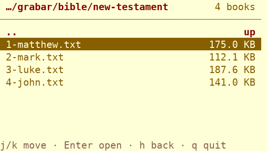
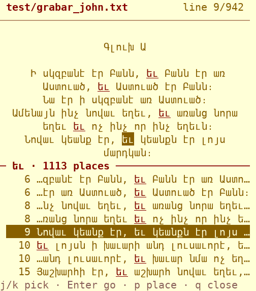
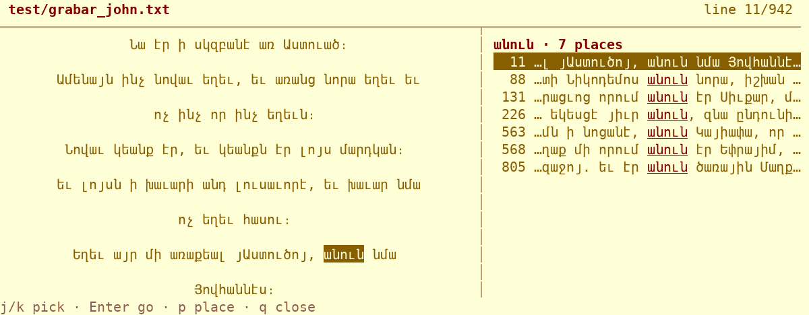
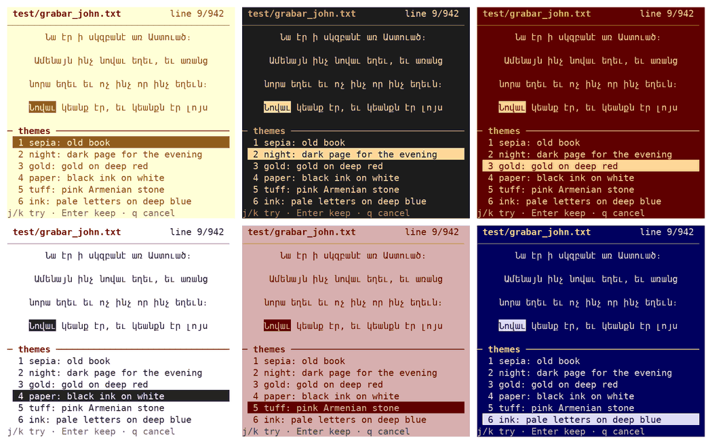

<p align="center">
  
</p>

# nx-gir

**A terminal book reader built for Grabar (Classical Armenian) texts.**

nx-gir (from Armenian *գիր*, "letter, script") is a book reader that runs in the
terminal. Its main goal is to make old Armenian texts easier to read: Grabar
books, early printed editions, and scanned manuscripts. It also turns scanned
PDFs and images into plain text, so a page photo can be read like any other book.

> **Status:** early planning. This README describes what the project is meant to do.
> None of it is implemented yet.

## Goals

### 1. Terminal reader

- Read `.txt`, `.md`, `.epub`, and text-based `.pdf` files in the terminal
- Full Unicode Armenian rendering, including classical punctuation
  (`։ ՝ ՛ ՞ ՜`) and ligatures (`և`, `ﬓ ﬔ ﬕ ﬖ ﬗ`)
- Pagination, search, bookmarks, and remembering where you stopped
- Keyboard-driven navigation

### 2. Scan → text (OCR)

- Convert scanned PDFs and images (`.png`, `.jpg`, `.tiff`) to `.txt` files
- Uses [Tesseract](https://github.com/tesseract-ocr/tesseract) with Armenian
  (`hye`) language data
- Image cleanup before OCR (grayscale, binarization, deskew) for old, worn prints
- Post-OCR cleanup tuned for Armenian: normalizing ligatures and fixing common
  misread characters

### 3. Grabar reading aids (the main feature)

Tools that help a modern reader through a Classical Armenian text:

- **Abbreviation expansion.** Expand common abbreviations and *nomina sacra*
  marked with the abbreviation sign `՟` (e.g. `ա՟ծ` → `աստուած`, `ք՟ս` → `Քրիստոս`).
- **Modern spelling view.** Show the text in reformed (modern Eastern Armenian)
  orthography next to the classical one (e.g. `յոյս` → `հույս`, `իւր` → `յուր`).
  This is approximate and rule-based, and the original text is always kept.
- **Transliteration.** Show the text in Latin script using the Hübschmann–Meillet
  scheme, the standard in Classical Armenian scholarship.
- **Glossary lookup.** Look up a Grabar word under the cursor, with basic
  handling of case endings and articles (`-ոյ`, `-աց`, `-ոց`, `-աւ`, `-ս/-դ/-ն`, …).
  Ships with a small starter glossary and can load your own dictionaries (TSV).
- **Armenian numerals.** Convert letter-numerals (`Ա`=1 … `Ք`=9000) to Arabic
  numbers, and convert dates in the Armenian era (*թուին*, +551) to AD years.
  Useful for chapter numbers, verses, and manuscript colophons.
- **Punctuation guide.** Explain classical punctuation marks inline.

## Planned usage

```sh
# open the interactive nxgir shell ('help' lists the
# commands, Tab completes them, 'exit' quits)
./nxgir

# or run a single command directly, e.g. browse the
# books in books/ and data/ by folder (Enter opens,
# h goes up, / searches, q quits)
./nxgir bookshelf

# print the book list instead of browsing it
./nxgir bookshelf --plain

# print the logo: hy (default), hy-upright, hy-block, en
./nxgir banner en

# read a book
./nxgir read book.txt

# OCR a scanned PDF or image into a text file
./nxgir ocr scan.pdf -o scan.txt --lang hye

# Grabar helpers: list the abbreviations of old
# manuscripts, or expand one (ած, ԱԾ and ա՟ծ all work)
./nxgir grabar abbr
./nxgir grabar abbr ա՟ծ
./nxgir grabar modernize text.txt
./nxgir grabar translit text.txt
./nxgir grabar numeral ՌՄԾ
```

## Books

The bookshelf shows the texts in two folders:

- `books/`: the library, in Grabar: the four Gospels
  from the Venice 1895 Bible
  (`books/grabar/bible/new-testament/`) and three works
  of Grigor Tatevatsi from Digilib
  (`books/grabar/grigor-tatevatsi/`, in parts); see
  `books/SOURCES.md`.
- `data/`: short test texts; see `data/SOURCES.md`.

The bookshelf shows them as folders (`grabar/`,
`test/`, …), with the number of books in each:

| Key | Action |
|-----|--------|
| `j` `k` / `↓` `↑`, `g` `G`, `PgUp` `PgDn` | move |
| `Enter` / `l` / `→` | open the folder or book |
| `h` / `←` / `Backspace`, or `..` | up one folder |
| `/` then `n` `N` | find a book by name in any folder |
| `T`, `d` | theme, dim (as in the reader) |
| `q` | quit |

Going up puts the cursor back on the folder you came
from, and the bookshelf reopens in the folder you were
last in. `./nxgir bookshelf --plain` prints every book
with its full path.

More books of the 1895 Bible can be added with
`scripts/fetch-bible.py` (see its help and
`books/SOURCES.md` for the commands used).

## Reader keys

<p align="center">
  
  
</p>

Pressing Enter on a book in the bookshelf opens it in
the reader.
The text wraps to the screen and re-wraps when the
window size changes. Lines are centered, in a column at
most 70 characters wide in the middle of the screen, with
an empty margin of 10% of the width on the left and right.
Lines are double-spaced (an empty row between them),
since a terminal can't change its own line height. One
word is under the cursor.

| Key | Action |
|-----|--------|
| `w` `b` / `l` `h` / `→` `←` | next / previous word |
| `j` `k` / `↓` `↑` | word on the next / previous line |
| `0` `$` | first / last word on the line |
| `g` `G` | first / last word of the book |
| `space` / `Ctrl-f` `Ctrl-b` / `PgDn` `PgUp` | page down / up |
| `/` then `n` `N` | find a word, next / previous match |
| `s` | references: every place the word appears |
| `p` | panel place: auto, always below, always beside |
| `c` | lines centered (default) or left-aligned |
| `L` | line spacing: double (default) → triple → single |
| `T` | choose a theme (`j`/`k` try it on the page, `Enter` keep, `q` cancel) |
| `d` | dim the text: normal → dim → dimmer (also in the bookshelf) |
| `m` | bookmark the word (again to remove); `*` in the top line marks it |
| `M` | list bookmarks (`j`/`k` preview, `Enter` go, `x` delete, `q` close) |
| `q` | back to the list |

In the references panel, `j`/`k` move through the places
(the text follows), `Enter` goes there, and `q` returns
to where you were. The panel opens beside the text on
wide screens (90+ columns) and below it on narrow ones,
and moves when the window is resized or the phone is
rotated. Matching ignores case and the marks
`՛ ՜ ՞`, and treats `և` and `եւ` as the same.

<p align="center">
  
</p>

The reader remembers where you stopped in each book and
opens it there next time; the bookshelf shows how far
you've read (`37%`). Bookmarks, the theme, the dim level,
centering, line spacing and the panel place are
remembered too. All of
it is kept in `~/.local/state/nxgir/state.json` on your
device (not in the repo); set `NXGIR_STATE` to use
another file. If the file is damaged, nxgir starts fresh
and keeps the old one as `state.bad`.

Themes:

| Theme | Look |
|-------|------|
| sepia (default) | old book: cream paper, brown ink, red headings |
| night | dark page for the evening |
| gold | gold on deep red, like the logo |
| paper | black ink on white |
| tuff | pink Armenian tuff stone |
| ink | pale letters on deep blue |
| plain | the terminal's own colors |

<p align="center">
  
</p>

The colored themes need a 256-color terminal, which
Termux and most terminals are; otherwise plain is used.
In the bookshelf, `T` steps to the next theme. To start
in another theme, set `NXGIR_THEME`, e.g.
`NXGIR_THEME=night ./nxgir`.

The font is chosen by the terminal, not by nx-gir. In
Termux, use the Termux:Styling add-on (long-press →
More → Style → Choose font) or copy a monospace `.ttf`
to `~/.termux/font.ttf` and run `termux-reload-settings`.
Pick a font that has Armenian letters, such as DejaVu
Sans Mono.

## Requirements (planned)

- Python 3.10+
- A terminal with a font that covers Armenian (e.g. DejaVu Sans Mono, Noto Sans Mono)
- For OCR: Tesseract with Armenian data
  (`apt install tesseract-ocr tesseract-ocr-hye`)

## Code style

All code is limited to **60 characters per line**, so it
fits a phone screen. The limit is set in `pyproject.toml`
(ruff) and `.editorconfig`. Check with:

```sh
pip install ruff pytest
ruff format scripts/ tests/
ruff check scripts/ tests/
python3 -m pytest
```

The logo image at the top of this README is generated
from the logo in the CLI. After changing the logo,
regenerate it:

```sh
scripts/render-logo.py
```

The screenshots in this README are made by running
nxgir in a simulated terminal. After changing the
screens, regenerate them (needs `pip install pyte
pillow`):

```sh
scripts/render-screens.py
```

## Contributing

Grabar texts, glossaries, and lists of abbreviations are especially welcome,
along with test scans of old prints.

## License

TBD
