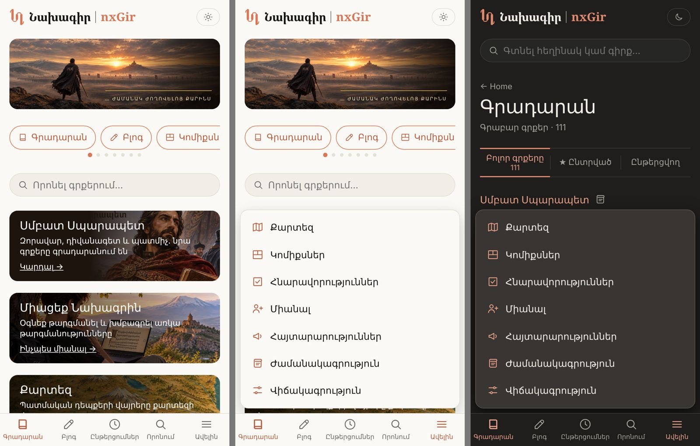
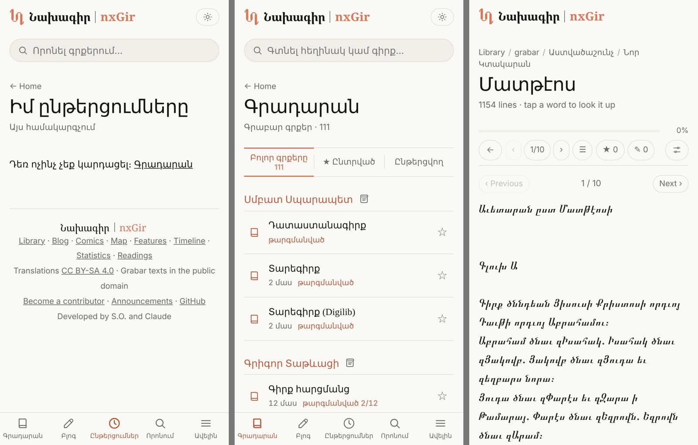
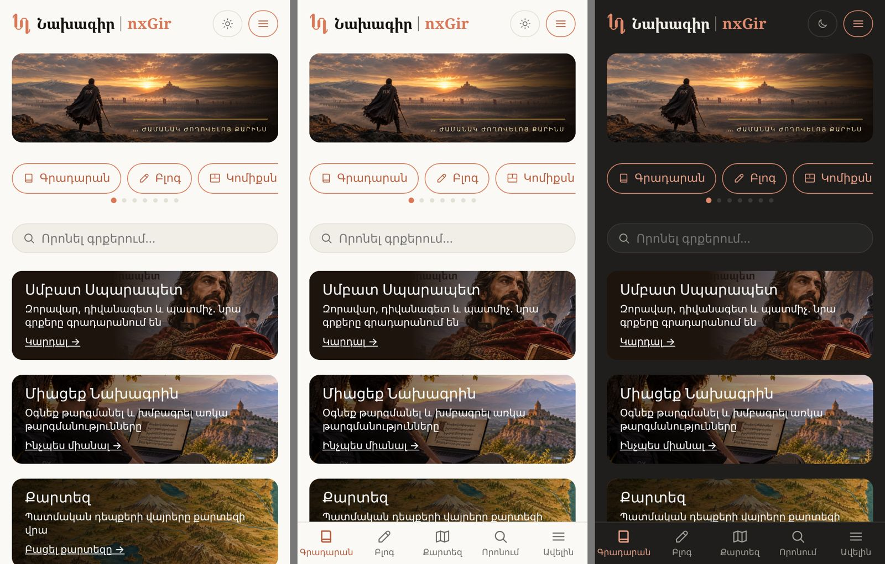
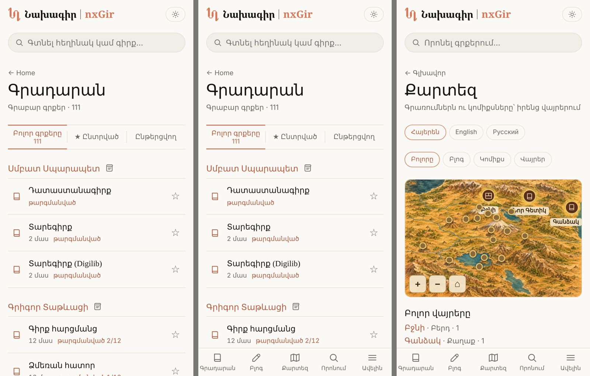
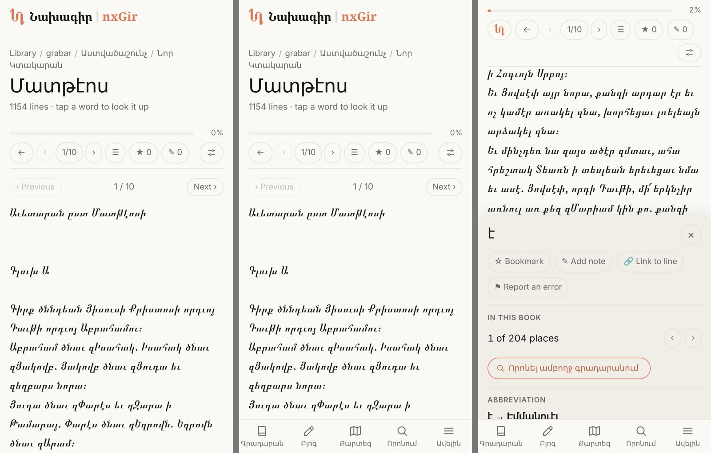

# Bottom navigation tabs on phones: plan

Status: **built** (2026-11-22). Tabs: Library, Blog,
Readings, Search, More (Map moved into More). Hidden in
the reader and while typing. Left: home, More sheet
open, the same in dark; right: Readings, Library, the
reader (no bar):

Code: `TABS`, `MORE`, `tabFor()`, `tabBar()` in
`web/app.js`; `.tabbar` at the end of `web/style.css`.
Below is the original plan.

## Why

On a phone the way to the main pages is far from the
thumb: the ☰ button (top right, top page only), the
swipeable button row on the top page, or the footer at
the very bottom of a long page. Every other page has
only the logo and a "← Home" link. A bottom bar of
tabs puts the five main places one tap away, on every
page, in the thumb zone.

## Mock-ups (390x760 phone, made with Playwright)

Left: now. Middle: with the bar. Right: dark theme.
Top page and Library:

Library, Map:

Reader (right: word panel open, bar visible). See
"Reader" below: the plan is to **hide the bar there**.

## The tabs

| Tab | Icon | Goes to | Active on |
| --- | --- | --- | --- |
| Գրադարան | book | `#/library` | `#/`, `library`, `b/`, `f/` |
| Բլոգ | pen | `#/blog` | `blog/*`, `comics/*` |
| Քարտեզ | map | `#/map` | `map/*` |
| Որոնում | search | `#/search` | `search` |
| Ավելին | menu | opens a sheet | the rest |

"Ավելին" (More) opens a sheet from the bottom with the
rest of `MENU` and the footer's pages: Comics,
Features, Contribute, Announcements, Timeline,
Statistics, Readings, Offline. It replaces the ☰ panel
of the top page (`headerMenu()`), which then is not
needed on a phone.

Open question for the user: is Search better than
Readings (`#/recent`, "continue where I stopped") as
the fourth tab? Search already has a box at the top of
every page, so Readings may be the more useful tab.

## Implementation

All in `web/`, no build step, no inline styles (CSP).

1. `app.js`: `tabBar()`, built from one `TABS` table
   like `MENU` (reuse `menuLink`'s shape and `ICONS`);
   appended once after `headerMenu()`. `route()` sets
   `aria-current="page"` on the active tab (a small
   `tabFor(hash)` function; a test checks every route
   maps to a tab or to More). Labels in Armenian,
   `lang="hy"`, like the menu.
2. `app.js`: the More sheet reuses the `menu-panel`
   code (open/close, Escape, outside tap, hashchange);
   share it instead of copying. Move the extra pages
   list out of `siteFooter()` into one `PAGES` table
   used by both.
3. `style.css`: `.tabbar` fixed at the bottom,
   `env(safe-area-inset-bottom)` for notched phones,
   `body { padding-bottom }` equal to the bar so the
   footer is never covered, `min-height: 52px` touch
   targets, accent for the active tab. Only under
   `@media (max-width: 40rem)`; on wide screens the
   header stays as it is. Works in light, dark and
   black themes with the existing variables.
4. Things at the bottom that must move up by the
   bar's height (a `--tabbar` variable): the word
   panel (`.panel`, `bottom: 0`), `.sel-search`,
   `body.panel-open main` padding, the map's docked
   `.map-pop.dock`, toasts.
5. `static.js` / `sw.js`: nothing new to cache (no
   new files). The installed app (standalone) gets
   the same bar.
6. Docs: Features page (all three languages), a
   Timeline line, README screenshots via
   `scripts/render-web.py` (add one phone shot).
   `tests/test_web.py` / a JS check for the TABS table
   and the CSS variable names.

## Reader

The reader already has its own tool row at the top and
the word panel at the bottom. A permanent bar there
costs 56px of a 760px screen (7%), and the panel would
sit on top of it. **Recommendation: hide the bar
while reading** (`body.reading .tabbar`) and keep the
reader's own ← back button; the bar returns on every
other page. A middle way if wanted: hide it only while
scrolling down and show it on scroll up.

## Risks

- Height: 7% of the screen on every page. Mitigation:
  hide in the reader; hide on scroll down (optional).
- Keyboard: with `interactive-widget=resizes-content`
  the bar rides above the keyboard in the search
  box; hide it while an input is focused.
- Four of five tabs duplicate the top page's buttons:
  keep the button row (it is also the banner area)
  but the dots under it can go.
- The mock-up is an injected prototype: spacing, the
  More sheet and the dark/black themes still need a
  real pass.

## Order of work

1. TABS table, bar, styles, active state (phone only).
2. Move the fixed bottom things up (panel, map, toast).
3. More sheet; unify with the ☰ panel and footer.
4. Hide in the reader and on input focus.
5. Tests, Features page, Timeline, screenshots.
